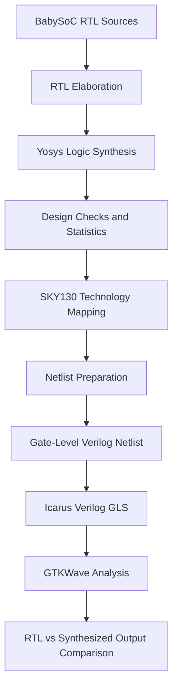

# BabySoC Logic Synthesis & Gate-Level Verification

<p align="center">
  
  
  
  
</p>

<p align="center">
  <b>Exploring the transformation of RTL into a technology-mapped netlist and validating its functional behavior through Gate-Level Simulation.</b>
</p>

---

## Overview

This experiment focuses on the logic synthesis and post-synthesis verification of the **BabySoC design**. The RTL source files were processed using Yosys, mapped to SKY130 high-density standard cells, and prepared for Gate-Level Simulation (GLS).

The synthesized design was then compiled using Icarus Verilog with the required functional cell models. GTKWave was used to inspect simulation waveforms and compare the behavior of the RTL and synthesized implementations.

The experiment provides practical insight into the relationship between RTL descriptions, synthesized logic, standard-cell mapping, and functional verification.

### Objectives

- Load and analyze the BabySoC RTL hierarchy.
- Perform synthesis using Yosys.
- Examine design statistics and structural consistency.
- Map sequential and combinational logic to SKY130 standard cells.
- Generate a technology-mapped Verilog netlist.
- Configure a testbench for RTL and gate-level simulation.
- Execute post-synthesis functional simulation.
- Compare pre-synthesis and post-synthesis waveforms.

## Design Implementation Flow



---

## 01 — RTL Source Integration

The synthesis process begins by loading the BabySoC top-level module and its supporting RTL modules into Yosys.

```bash
yosys
```

The following source files are read into the synthesis environment:

```tcl
read_verilog src/module/vsdbabysoc.v
read_verilog -I src/include src/module/rvmyth.v
read_verilog -I src/include src/module/clk_gate.v
```

The `vsdbabysoc` module serves as the top-level design, while `rvmyth` and `clk_gate` provide supporting processor and clock-gating functionality.

### Figure 1 — RTL Source Integration in Yosys


*The source-loading stage establishes the RTL modules required for synthesis.*

---

## 02 — Library Configuration and Logic Synthesis

Technology-library information is loaded to provide the functional and timing characteristics required for synthesis and cell mapping.

```tcl
read_liberty -lib src/lib/avsdpll.lib
read_liberty -lib src/lib/avsddac.lib
read_liberty -lib src/lib/sky130_fd_sc_hd__tt_025C_1v80.lib

synth -top vsdbabysoc
```

The libraries represent the PLL, DAC, and SKY130 standard-cell components used by the design.

The `synth` command performs the synthesis process with `vsdbabysoc` designated as the top-level module.

### Figure 2 — BabySoC Hierarchy Inspection


*The hierarchy view illustrates the organization and interconnection of the design modules.*

---

## 03 — Synthesis Reports and Structural Analysis

After synthesis, Yosys provides statistics describing the resulting design. These reports help examine the design hierarchy, ports, wires, and cells.

### Figure 3 — Synthesized Design Statistics


*The synthesis report provides an overview of the structure and complexity of the synthesized design.*

---

## 04 — Structural Consistency Check

The Yosys `check` pass is used to identify structural problems in the synthesized design.

The reported result was:

```text
Found and reported 0 problems.
```

This indicates that the check did not identify any structural issues covered by that pass. Functional verification is performed separately through simulation.

### Figure 4 — Yosys Structural Verification


---

## 05 — SKY130 Standard-Cell Technology Mapping

The synthesized logic is mapped to cells available in the SKY130 high-density standard-cell library.

Sequential elements are mapped using the `dfflibmap` command:

```tcl
dfflibmap -liberty src/lib/sky130_fd_sc_hd__tt_025C_1v80.lib
```

Combinational logic mapping is performed using ABC:

```tcl
abc -liberty src/lib/sky130_fd_sc_hd__tt_025C_1v80.lib
```

This stage maps supported logic functions to library cells, including appropriate gates, multiplexers, and sequential elements.

### Figure 5 — SKY130 Technology Mapping Results


*The ABC results show the standard-cell mapping performed for the combinational logic.*

---

## 06 — Synthesized Netlist Visualization

The `show` command provides a graphical representation of the synthesized design.

```tcl
show vsdbabysoc
```

The visualization helps inspect internal logic connectivity and understand how the original RTL hierarchy is represented in the synthesized circuit.

### Figure 6 — Technology-Mapped Design Visualization


*The diagram provides a visual representation of the synthesized logic and its internal connections.*

---

## 07 — Netlist Flattening and Cleanup

Before exporting the gate-level implementation, the design is flattened and cleaned.

```tcl
flatten
setundef -zero
clean -purge
rename -enumerate
```

The commands serve the following purposes:

| Command | Function |
|---|---|
| `flatten` | Merges the module hierarchy into a flattened design representation. |
| `setundef -zero` | Replaces undefined values with logic zero according to the selected synthesis policy. |
| `clean -purge` | Removes unused objects and unnecessary internal elements. |
| `rename -enumerate` | Renames internal objects systematically. |

These operations prepare the design representation for netlist export. The undefined-value replacement is a design decision and should be considered when interpreting simulation behavior.

---

## 08 — Gate-Level Netlist Export

The technology-mapped design is exported as a Verilog netlist.

```tcl
write_verilog -noattr baby_soc_netlist3.v
```

The output file contains the synthesized circuit representation, including mapped logic cells and their connections.

### Figure 7 — Exported Gate-Level Netlist


*The exported Verilog netlist is used as the design input for post-synthesis functional simulation.*

---

## 09 — Testbench Configuration

A shared testbench supports both RTL simulation and post-synthesis simulation through conditional compilation.

The following directives select the design representation:

```verilog
`ifdef PRE_SYNTH_SIM
```

This branch selects the RTL design for pre-synthesis simulation.

```verilog
`elsif POST_SYNTH_SIM
```

This branch selects the synthesized netlist and associated cell models for post-synthesis simulation.

The testbench initializes and drives important design inputs, including:

- `reset`
- `VREF`
- `REF`
- `ENb_CP`
- `ENb_VCO`
- `VCO_IN`

### Figure 8 — Testbench for Functional Verification


*The testbench provides the input stimulus needed to observe and compare design behavior.*

---

## 10 — Post-Synthesis Gate-Level Simulation

Icarus Verilog is used to compile the testbench with the synthesized design and the required SKY130 functional models.

```bash
sudo iverilog \
  -DPOST_SYNTH_SIM \
  -DFUNCTIONAL \
  -I src/include/ \
  -I ../../sky130RTLDesignAndSynthesisWorkshop/my_lib/verilog_model/ \
  -I src/module/ \
  src/module/testbench.v
```

### Compilation options

| Option | Purpose |
|---|---|
| `-DPOST_SYNTH_SIM` | Selects the post-synthesis simulation branch. |
| `-DFUNCTIONAL` | Enables the functional model configuration where supported by the cell models. |
| `-I src/include/` | Adds the design include directory. |
| `-I ../../sky130RTLDesignAndSynthesisWorkshop/my_lib/verilog_model/` | Adds the SKY130 Verilog model directory. |
| `-I src/module/` | Adds the module source directory. |

The command assumes that the file paths and testbench configuration match the local project structure.

Run the compiled simulation:

```bash
./a.out
```

Open the generated waveform file:

```bash
gtkwave post_synth_sim.vcd
```

GTKWave allows the observed signals and transitions to be inspected over simulation time.

---

## 11 — RTL and Gate-Level Waveform Comparison

The final verification stage compares the pre-synthesis and post-synthesis simulation waveforms.

The primary signals examined include:

- `CLK`
- `reset`
- `OUT`
- `RV_TO_DAC`

### Figure 9 — Pre-Synthesis and Post-Synthesis Waveform Comparison


*Comparing the observed signals helps assess whether synthesis preserved the intended functional behavior under the applied testbench stimulus.*

A meaningful comparison should account for reset conditions, initial values, clock activity, and the availability of functional models for all required cells.

---

## 📊 Results and Observations

The following activities were completed as part of the documented synthesis and GLS workflow:

- Loaded the BabySoC RTL source files into Yosys.
- Included the required PLL, DAC, and SKY130 library descriptions.
- Synthesized the design using `vsdbabysoc` as the top module.
- Examined the hierarchy and synthesis statistics.
- Ran the Yosys structural check, which reported zero problems.
- Performed sequential and combinational standard-cell mapping.
- Inspected the synthesized logic representation.
- Flattened and cleaned the design before export.
- Generated the gate-level Verilog netlist.
- Configured the testbench for post-synthesis simulation.
- Compiled the simulation using Icarus Verilog and the functional cell models.
- Inspected the resulting waveform in GTKWave.
- Compared selected signals between the RTL and synthesized simulations.

## Conclusion

This experiment demonstrates the progression of the BabySoC design from RTL source code to a technology-mapped gate-level representation.

Yosys was used for synthesis, structural checking, and preparation of the mapped design. The SKY130 standard-cell library provided the technology information for mapping, while Icarus Verilog and GTKWave supported post-synthesis simulation and waveform inspection.

The comparison of RTL and gate-level behavior forms an important part of the verification process, helping identify functional differences introduced by design configuration, initialization, or synthesis-related issues.

**Overall flow:**

**RTL Integration → Logic Synthesis → Structural Checking → SKY130 Mapping → Netlist Export → Gate-Level Simulation → Waveform Comparison**

This hands-on exercise strengthened my understanding of logic synthesis, standard-cell mapping, netlist generation, and functional verification in an open-source VLSI design environment.

---

<p align="center">
  <b>From RTL to Gates — Verify the Logic, Understand the Implementation.</b>
</p>
