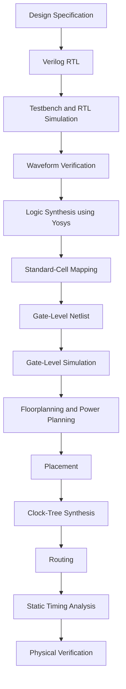

# RTL Design Workshop | VLSI Engineering Portfolio

  
  
  
  
  

  <b>A hands-on journey from Verilog RTL design and simulation to logic synthesis, standard-cell implementation, and ASIC physical design.</b>

  <a href="#-about-this-repository">About</a> •
  <a href="#-repository-navigation">Navigation</a> •
  <a href="#-rtl-design--synthesis">RTL Design</a> •
  <a href="#-asic-physical-design">Physical Design</a> •
  <a href="#-tools--technologies">Tools</a> •
  <a href="#-about-me">About Me</a>

---

## About This Repository

Welcome to my **RTL Design Workshop Repository**, documenting my practical learning journey in VLSI design through VSD training activities and hands-on laboratory exercises.

Here, I document my experiments with Verilog HDL, digital circuit simulation, testbench development, logic synthesis, standard-cell libraries, sequential logic optimization, gate-level simulation, and ASIC physical design.

I have organized my work into module-wise folders, day-wise learning notes, technical explanations, screenshots, waveforms, and implementation reports where available.

My goal is to understand not only how to write RTL code, but also how synthesis tools interpret the code, optimize the hardware, and prepare a digital design for physical implementation.

**Explore the repository:** [itsfari-nova/RTL_Design_Workshop](https://github.com/itsfari-nova/RTL_Design_Workshop)

## Learning Objectives

- Develop a strong foundation in Verilog RTL design.
- Simulate digital circuits and verify their functionality.
- Understand testbenches, VCD files, and waveform debugging.
- Explore Yosys synthesis and gate-level netlist generation.
- Study standard-cell libraries and timing characteristics.
- Understand hierarchical and flattened synthesis.
- Analyze combinational and sequential logic optimizations.
- Investigate synthesis-simulation mismatches.
- Explore SKY130 technology and standard-cell implementation.
- Understand floorplanning, power planning, placement, and clock-tree synthesis.
- Learn timing analysis and important ASIC implementation concepts.

---

## Repository Navigation

| Folder | What you'll find |
|---|---|
| [Module 1](./Module%201/) | RTL fundamentals, MUX simulation, Yosys synthesis, and standard-cell libraries |
| [Module 2](./Module%202/) | Hierarchical synthesis, flip-flop coding styles, and synthesis optimization |
| [Module 3](./Module%203/) | Combinational and sequential logic optimization |
| [Module 4](./Module%204/) | Gate-level simulation and synthesis-simulation mismatches |
| [Module 5](./Module%205%20/) | Conditional constructs, incomplete assignments, loops, and generate statements |
| [PD_Module 1](./PD_Module%201/) | ASIC physical-design flow using OpenLANE and SKY130 |
| [PD_Module 2](./PD_Module%202/) | Floorplanning, power integrity, placement, and standard-cell concepts |
| [PD_Module 3](./PD_Module%203/) | CMOS inverter design, characterization, layout, and fabrication |
| [PD_Module 4](./PD_Module%204/) | Pre-layout timing analysis, STA, clock-tree synthesis, and signal integrity |
| [PD_Module 5](./PD_Module%205/) | Physical-design module folder; documentation can be added as experiments are organized |
| [VSDBabySoC](./VSDBabySoC/) | VSDBabySoC workspace for SoC design-flow documentation |
| [VSD_VLSI — Week 1](./VSD_VLSI/Week%201/) | VLSI fundamentals and introductory RTL learning |
| [VSD_VLSI — Week 2](./VSD_VLSI/Week%202/) | VLSI design flow, simulation, and implementation concepts |

*Folder links use the existing repository paths. Some sections may need additional documentation as the workshop progresses.*

---

# 🔹 RTL Design & Synthesis

The RTL modules focus on how digital circuits are described, simulated, synthesized, and optimized using Verilog and open-source EDA tools.

## Module 1 — RTL Fundamentals and Synthesis

**Folder:** [`Module 1/`](./Module%201/)

### Day 1 — Introduction to RTL Design

I explored the basic elements of digital design, including the RTL description, testbench, simulator, and verification process. The hands-on experiment introduces a 2:1 multiplexer and its simulation.

Topics:
- Introduction to Verilog RTL.
- Design modules and testbenches.
- The role of a simulator.
- 2:1 multiplexer (`good_mux`).
- Icarus Verilog simulation.
- GTKWave waveform analysis.

[Read Day 1 documentation](./Module%201/Day1/README.md)

### Day 2 — RTL-to-Netlist Synthesis

I explored how the `good_mux` design is synthesized using Yosys and represented as a gate-level netlist.

Topics:
- RTL synthesis fundamentals.
- Yosys synthesis flow.
- Standard-cell library concepts.
- Gate-level netlist generation.
- Synthesized design inspection.

[Read Day 2 documentation](./Module%201/Day2/README.md)

### Day 3 — Exploring Standard-Cell Libraries

I examined the SKY130 standard-cell library to understand how logical functions are represented by physical library cells and how library information supports synthesis.

Topics:
- Liberty (`.lib`) files.
- Standard-cell characteristics.
- Power, voltage, and timing information.
- Technology-library exploration.

[Read Day 3 documentation](./Module%201/Day3/README.md)

### Selected Experiment: 2:1 MUX

The following image is an example of the MUX verification work stored in this repository.

[View the MUX source-code screenshot](./Module%201/Day1/good_mux_code.png) · [View simulation output](./Module%201/Day1/terminal_output.png)

---

## 🔹 Module 2 — Sequential Logic and Synthesis Optimization

**Folder:** [`Module 2/`](./Module%202/)

### Day 1 — Hierarchical and Flat Synthesis

I explored multi-module RTL designs and how hierarchy is handled during synthesis.

Topics:
- Multiple-module design.
- Top modules and submodules.
- Hierarchical synthesis.
- Flat synthesis.
- Synthesized design inspection.

[Read Day 1 documentation](./Module%202/Day1/README.md)

### Day 2 — Flip-Flop Coding Styles

I studied sequential logic and compared different reset and set behaviors through Verilog experiments and waveform analysis.

Topics:
- D flip-flops.
- Synchronous reset.
- Asynchronous reset.
- Asynchronous set.
- Flip-flop simulation.
- SKY130 standard-cell mapping concepts.

[Read Day 2 documentation](./Module%202/Day2/README.md)

### Day 3 — Synthesis Optimization Experiments

I explored how synthesis tools optimize arithmetic expressions and simplify hardware implementations.

Topics:
- Multiplication by constants.
- Multiplication of signals.
- RTL arithmetic expressions.
- Yosys optimization.
- Synthesized netlist visualization.

[Read Day 3 documentation](./Module%202/Day3/README.md)

---

## 🔹 Module 3 — Combinational and Sequential Optimization

**Folder:** [`Module 3/`](./Module%203/)

### Day 1 — Combinational Logic Optimization

I studied how synthesis tools simplify combinational logic while preserving the intended functionality.

Topics:
- Boolean logic minimization.
- Constant propagation.
- Redundant logic removal.
- Multi-module optimization.

[Read Day 1 documentation](./Module%203/Day1/README.md)

### Day 2 — Sequential Logic Optimization

I investigated how Yosys handles flip-flops, constant signals, and redundant sequential logic.

Topics:
- D flip-flop optimization.
- Constant D-input experiments.
- Reset behavior.
- Sequential logic simplification.
- Synthesis results.

[Read Day 2 documentation](./Module%203/Day2/README.md)

### Day 3 — Counter Optimization and Output Observability

I explored how the outputs used by a design can influence the hardware retained during synthesis.

Topics:
- 3-bit counter.
- Unused outputs.
- Sequential logic observability.
- Counter optimization.
- Synthesized logic inspection.

[Read Day 3 documentation](./Module%203/Day3/README.md)

---

## 🔹 Module 4 — Gate-Level Simulation and RTL Debugging

**Folder:** [`Module 4/`](./Module%204/)

### Day 1 — Gate-Level Simulation of a MUX

I examined how a 2:1 multiplexer moves from RTL simulation to a synthesized netlist and gate-level simulation.

Topics:
- Gate-Level Simulation (GLS).
- Ternary-operator MUX.
- Yosys synthesis.
- Netlist generation.
- RTL and gate-level behavior comparison.

[Read Day 1 documentation](./Module%204/Day1/README.md)

### Day 2 — Synthesis-Simulation Mismatches

I studied how Verilog coding style can affect simulation behavior and why RTL should accurately represent the intended hardware.

Topics:
- Blocking assignments (`=`).
- Non-blocking assignments (`<=`).
- Sequential logic coding practices.
- Incorrect MUX behavior.
- Synthesis-simulation mismatch.
- RTL versus gate-level verification.

[Read Day 2 documentation](./Module%204/Day2/README.md)

---

## 🔹 Module 5 — Verilog Coding Constructs

**Folder:** [`Module 5/`](./Module%205%20/)

### Day 1 — Conditional Constructs

I explored how conditional statements describe decision-making behavior and how incomplete assignments can cause unintended latch inference.

Topics:
- `if`, `else`, and `else if`.
- `case` statements.
- Complete and incomplete conditions.
- Default assignments.
- Latch inference.
- Simulation and synthesis comparison.

[Read Day 1 documentation](./Module%205%20/Day1/README.md)

### Day 2 — Loops and Generate Constructs

I studied how Verilog loops describe repetitive operations and repeated hardware structures.

Topics:
- Procedural `for` loops.
- Generate loops.
- MUX and DEMUX implementations.
- Ripple Carry Adder (RCA).
- Testbench and waveform analysis.

[Read Day 2 documentation](./Module%205%20/Day2/README.md)

---

# 🔹 VSD VLSI Learning Sessions

**Folder:** [`VSD_VLSI/`](./VSD_VLSI/)

## Week 1 — Introduction to VLSI and RTL

The first week documents my introduction to VLSI concepts, the design flow, Verilog, and the development environment.

Topics include:
- VLSI and integrated-circuit fundamentals.
- Introduction to digital IC design.
- Verilog and RTL.
- GitHub Codespaces.
- Linux commands and development tools.
- Introduction to the `good_mux` experiment.

[Explore Week 1](./VSD_VLSI/Week%201/README.md)

## Week 2 — Understanding the VLSI Design Flow

The second week explores the stages involved in developing a digital design, from specification and RTL through simulation, synthesis, and physical implementation.

Topics include:
- VLSI design-flow fundamentals.
- Pre-synthesis simulation.
- GTKWave waveform analysis.
- Clock and reset signals.
- Digital output observation.
- Introduction to implementation and verification.

[Explore Week 2](./VSD_VLSI/Week%202/README.md)

---

# ASIC Physical Design

The physical-design modules introduce the tools, libraries, and implementation stages used to transform a synthesized digital design into a physical layout.

## PD Module 1 — ASIC Implementation Flow

**Folder:** [`PD_Module 1/`](./PD_Module%201/)

I explored the overall ASIC physical-design flow using OpenLANE and the SKY130 PDK.

Topics:
- ASIC implementation flow.
- Floorplanning and power planning.
- Placement and optimization.
- Clock-Tree Synthesis (CTS).
- Global and detailed routing.
- Timing analysis.
- Antenna checks.
- DRC and LVS concepts.

[Explore PD Module 1](./PD_Module%201/README.md)

## PD Module 2 — Floorplanning and Power Integrity

**Folder:** [`PD_Module 2/`](./PD_Module%202/)

I studied how the floorplan and power-distribution decisions affect the physical implementation of a chip.

Topics:
- Core and die dimensions.
- Utilization and aspect ratio.
- Pre-placed cells.
- Power planning and decoupling capacitors.
- Pin placement.
- Global and detailed placement.
- Standard-cell characterization.
- Introduction to CTS.
- Physical-design experiments using OpenLane.

[Explore PD Module 2](./PD_Module%202/README.md)

## PD Module 3 — CMOS Design and Standard-Cell Layout

**Folder:** [`PD_Module 3/`](./PD_Module%203/)

I explored CMOS inverter design, electrical characterization, standard-cell layout, and the relationship between circuit behavior and physical implementation.

Topics:
- CMOS inverter operation.
- SPICE simulation using ngspice.
- Transient waveforms.
- Rise time and fall time.
- Propagation delay.
- Voltage Transfer Characteristic (VTC).
- SKY130 standard-cell layout.
- Layout extraction and post-layout simulation.
- CMOS fabrication concepts.

[Explore PD Module 3](./PD_Module%203/README.md)

## PD Module 4 — Timing Analysis and Clock Distribution

**Folder:** [`PD_Module 4/`](./PD_Module%204/)

I studied how timing constraints, clock distribution, and standard-cell delays influence the behavior of synchronous digital circuits.

Topics:
- Static Timing Analysis (STA).
- Standard-cell timing libraries.
- Delay modeling.
- Setup time and timing violations.
- Clock uncertainty and jitter.
- Pre-layout timing analysis.
- Timing optimization.
- Clock-Tree Synthesis.
- Clock buffering and routing.
- Signal integrity and crosstalk.

[Explore PD Module 4](./PD_Module%204/README.md)

## PD Module 5 — Physical Design Workspace

**Folder:** [`PD_Module 5/`](./PD_Module%205/)

This folder is reserved for additional physical-design learning material. Add its detailed README and experiment links when the corresponding content is available.

---

# VSDBabySoC Workspace

**Folder:** [`VSDBabySoC/`](./VSDBabySoC/)

This folder is available in the repository for VSDBabySoC-related learning and design-flow documentation.

The VSDBabySoC work can be documented here as the corresponding files and experiments are organized, including:

- RTL design and simulation.
- Synthesis and gate-level verification.
- Standard-cell implementation.
- Physical-design exploration.
- Timing analysis.

[Explore the VSDBabySoC folder](./VSDBabySoC/)

---

## General RTL-to-Physical-Design Flow

The following diagram summarizes the major stages studied throughout the workshop.

*This is a conceptual overview of the design flow, not a claim that every repository experiment completed every implementation stage.*

---

## Tools & Technologies

| Tool / Technology | Application |
|---|---|
| Verilog HDL | RTL design and digital hardware description |
| Icarus Verilog | RTL and gate-level simulation |
| GTKWave | Waveform inspection and debugging |
| Yosys | Logic synthesis and technology mapping |
| SKY130 PDK | Open-source semiconductor process technology |
| OpenLANE | ASIC implementation flow |
| OpenROAD | Physical-design implementation |
| OpenSTA | Static Timing Analysis |
| Magic | Layout editing and design-rule checking |
| ngspice | Circuit simulation and characterization |
| TritonCTS | Clock-Tree Synthesis |
| TritonRoute | Detailed routing |
| Git | Version control |
| GitHub | Source-code hosting and documentation |
| Linux Terminal | Tool execution and scripting |

---

## Key Learning Outcomes

Through the workshop, I explored:

- How Verilog RTL describes digital hardware.
- How testbenches verify circuit functionality.
- How simulation waveforms help debug designs.
- How Yosys converts RTL into synthesized logic.
- How standard-cell libraries support technology mapping.
- How hierarchical and flat synthesis differ.
- How synthesis optimization affects combinational and sequential logic.
- How coding mistakes can lead to latches or mismatches.
- How CMOS cells are simulated and characterized.
- How floorplanning, placement, CTS, and routing contribute to ASIC implementation.
- How timing analysis supports reliable synchronous circuit design.

---

## 📚 Reference Documentation

- [Yosys Documentation](https://yosyshq.readthedocs.io/)
- [OpenROAD Documentation](https://openroad.readthedocs.io/)
- [Icarus Verilog](https://steveicarus.github.io/iverilog/)
- [GTKWave](https://gtkwave.sourceforge.net/)
- [SkyWater SKY130 PDK](https://github.com/google/skywater-pdk)
- [VLSI System Design](https://www.vlsisystemdesign.com/)

---

## About Me

**Shaik Farida**  
Electronics and Communication Engineering (ECE)  
Areas of Interest: VLSI Design, Digital Design, and Embedded Systems

I am an ECE student developing my skills in digital hardware design, Verilog RTL, logic synthesis, and open-source ASIC implementation through hands-on learning and practical experiments.

This repository represents my progress in understanding the journey from RTL descriptions to synthesized hardware and physical-design concepts. I continue to document my experiments, observations, and technical learnings as I grow in the field of VLSI engineering.

---

  <b>Learning by Designing. Understanding Through Simulation. Growing Through VLSI.</b>

  ⭐ Thank you for exploring my RTL Design Workshop Repository! ⭐

