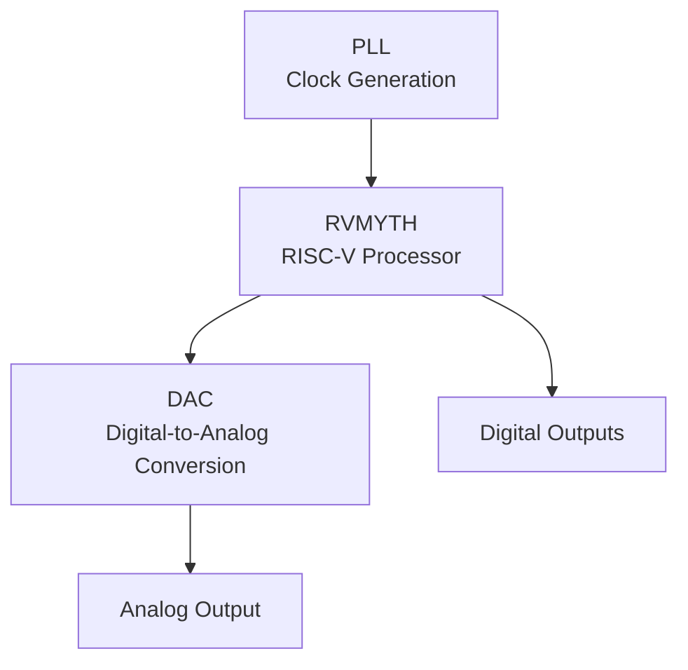
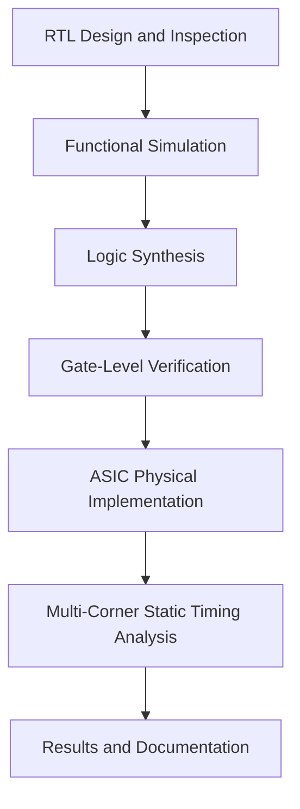

# RTL Design, Synthesis & ASIC Physical Design Workshop

<p align="center">
  
  
  
  
  
</p>

<p align="center">
  <b>A hands-on journey through RTL design, functional verification, logic synthesis, optimization, ASIC physical implementation, and static timing analysis.</b>
</p>

<p align="center">
  <a href="#-overview">Overview</a> •
  <a href="#-quick-navigation">Navigation</a> •
  <a href="#-rtl-design--synthesis-modules">RTL Modules</a> •
  <a href="#-vsdbabysoc-project">VSDBabySoC</a> •
  <a href="#-physical-design-modules">Physical Design</a> •
  <a href="#-tools--technologies">Tools</a> •
  <a href="#-author">Author</a>
</p>

---

## Overview

Welcome to my **RTL Design Workshop repository**, where I document my practical learning experience in digital design, Verilog programming, simulation, synthesis, optimization, and open-source ASIC implementation.

This repository brings together my workshop modules, practical experiments, design observations, simulation results, timing reports, and technical documentation. It also includes my work on **VSDBabySoC**, covering the progression from RTL-level understanding to synthesis, physical implementation, and multi-corner Static Timing Analysis (STA).

Rather than focusing only on theoretical concepts, I use this repository to understand how hardware designs are described, verified, mapped to standard cells, physically implemented, and evaluated against timing constraints.

The repository is organized into dedicated sections so that each module and implementation stage can be explored independently.

## Objectives

- Develop a practical understanding of Verilog RTL design and digital logic.
- Write and verify combinational and sequential circuits.
- Explore simulation, waveform analysis, and testbench development.
- Understand RTL synthesis, technology mapping, and logic optimization.
- Investigate gate-level simulation and synthesis-simulation mismatches.
- Study the SKY130 process design kit and open-source EDA ecosystem.
- Explore floorplanning, placement, clock-tree synthesis, and routing.
- Understand Power Distribution Network (PDN) generation and physical verification.
- Analyze setup and hold timing using OpenSTA.
- Document the complete learning process with organized notes and supporting evidence.

---

## Quick Navigation

| Section | Description | Explore |
|---|---|---|
| RTL Design & Synthesis | Verilog, simulation, synthesis, and optimization | [View Modules](#-rtl-design--synthesis-modules) |
| VSDBabySoC | SoC design, verification, synthesis, and implementation | [Explore Project](#-vsdbabysoc-project) |
| Physical Design | Floorplanning, placement, CTS, routing, and timing | [View Modules](#-physical-design-modules) |
| Tools & Technologies | Open-source EDA tools and design formats | [View Tools](#-tools--technologies) |
| Learning Outcomes | Key technical concepts explored | [View Learnings](#-key-learning-outcomes) |

---

## Repository Contents

| Directory | Focus |
|---|---|
| `Module 0` – `Module 5` | RTL design, Verilog, simulation, synthesis, and optimization |
| `VSDBabySoC/` | Integrated SoC design and implementation documentation |
| `PD_Module 1` – `PD_Module 5` | ASIC physical design concepts and implementation flow |
| `VSD_VLSI/` | Additional VLSI workshop material, where available |
| `Assignment/` | Sequence detector design and verification, where available |

*The documentation and experiment files are maintained in their respective folders. Some sections contain detailed lab notes, screenshots, waveforms, or implementation reports.*

---

# RTL Design & Synthesis Modules

These modules focus on describing digital hardware using Verilog and understanding how RTL is simulated, synthesized, and optimized.

## Module 1 — Introduction to Verilog RTL Design and Synthesis

**Focus:** Understanding the basic RTL-to-netlist workflow.

Topics covered:
- Digital design and RTL design flow.
- Verilog modules and testbench development.
- Icarus Verilog simulation.
- GTKWave waveform analysis.
- 2:1 multiplexer implementation.
- Yosys synthesis.
- Standard-cell libraries and technology mapping.
- Gate-level netlist generation.

📂 [Explore Module 1](../Module%201/README.md)

## Module 2.1 — Timing Libraries, Hierarchical and Flat Synthesis

**Focus:** Understanding design hierarchy and synthesis structure.

Topics covered:
- RTL coding and module integration.
- Hierarchical versus flat synthesis.
- Multiple-module design.
- RTL simulation and verification.
- Synthesis using Yosys.
- Gate-level netlist analysis.
- Technology mapping and timing-library concepts.
- Efficient flip-flop coding styles.

📂 [Explore Module 2.1](../Module%202.1/README.md)

## Module 2.2 — Flip-Flop Design and SKY130 Technology Mapping

**Focus:** Sequential logic and flip-flop implementation.

Topics covered:
- Asynchronous-reset D flip-flop.
- Asynchronous-set D flip-flop.
- Synchronous-reset D flip-flop.
- Flip-flop simulation and synthesis.
- SKY130 standard-cell mapping.
- Synthesis optimization experiments.

📂 [Explore Module 2.2](../Module%202.2/README.md)

## Module 3 — Combinational and Sequential Logic Optimization

**Focus:** Exploring techniques that simplify or improve hardware implementation.

Topics covered:
- Constant propagation.
- State optimization.
- Logic cloning.
- Retiming concepts.
- Combinational logic optimization.
- Sequential logic optimization.
- Practical synthesis experiments.

📂 [Explore Module 3](../Module%203/README.md)

## Module 4 — Gate-Level Simulation and Synthesis-Simulation Mismatch

**Focus:** Understanding how simulation semantics relate to synthesized hardware.

Topics covered:
- Gate-Level Simulation (GLS).
- Blocking and non-blocking assignments.
- Synthesis-simulation mismatch.
- Ternary operators and multiplexer inference.
- RTL and gate-level behavior comparison.
- Common Verilog coding pitfalls.
- Correcting RTL and examining synthesis results.

📂 [Explore Module 4](../Module%204/README.md)

## Module 5 — RTL Coding Constructs and Synthesis Optimization

**Focus:** Understanding how coding styles influence hardware inference.

Topics covered:
- If-else and nested if-else statements.
- Inferred latches.
- Case statements and incomplete cases.
- For loops and generate blocks.
- Ripple Carry Adder (RCA).
- 4:1 multiplexer using a for loop.
- 8:1 demultiplexer using case and loop constructs.
- 8-bit ripple carry adder using a generate block.
- Synthesis behavior and optimization.

📂 [Explore Module 5](../Module%205/README.md)

---

# VSDBabySoC Project

## Project Overview

**VSDBabySoC** is an educational System-on-Chip project that combines a RISC-V-based processor with clock-generation and digital-to-analog conversion blocks.

My VSDBabySoC documentation explores the major stages of an ASIC development workflow, from RTL inspection and functional verification to logic synthesis, physical implementation, and multi-corner timing analysis.

The project provides a practical way to connect digital design concepts with the constraints and considerations involved in implementing a hardware design using the SKY130HD technology platform.

### Core components

| Component | Purpose |
|---|---|
| **RVMYTH** | RISC-V-based processor core for digital processing |
| **PLL** | Phase-Locked Loop block for clock generation |
| **DAC** | Digital-to-Analog Converter block for analog output conversion |

### High-level architecture



## VSDBabySoC — Complete Design Flow



## VSDBabySoC Documentation

### 01 — RTL Design and Functional Verification

Explore the RTL hierarchy, module interfaces, testbench concepts, simulation behavior, and waveform analysis.

**Key areas:**
- Verilog RTL inspection.
- Processor and peripheral integration.
- Functional simulation.
- Testbench verification.
- GTKWave signal analysis.

📂 [Open RTL Design and Functional Verification](./01_RTL_Design_and_Functional_Verification/README.md)

### 02 — Logic Synthesis and Gate-Level Verification

Explore how RTL is transformed into a gate-level netlist and how the synthesized design can be examined through simulation and reports.

**Key areas:**
- Yosys synthesis.
- Technology mapping.
- Synthesized netlist inspection.
- Gate-Level Simulation.
- RTL and gate-level behavior comparison.

📂 [Open Logic Synthesis and Gate-Level Verification](./02_Logic_Synthesis_and_Gate_Level_Verification/README.md)

### 03 — ASIC Physical Implementation

Explore the physical implementation stages of VSDBabySoC using the configured OpenROAD flow and SKY130HD platform.

**Key areas:**
- Technology and physical-library configuration.
- Floorplanning and macro placement.
- Tapcell insertion and PDN generation.
- Global and detailed placement.
- Clock Tree Synthesis.
- Global routing and routed-net inspection.
- Physical design logs, reports, and layout visualization.

📂 [Open ASIC Physical Implementation](./03_ASIC_Physical_Implementation/README.md)

### 04 — Multi-Corner Static Timing Analysis

Explore setup and hold timing behavior using OpenSTA and the configured SKY130HD timing libraries.

**Key areas:**
- Timing-library configuration.
- SDC constraints.
- PVT corner analysis.
- Setup and hold slack.
- Worst Slack and Total Negative Slack.
- Timing report extraction and comparison.
- Timing constraints and unconstrained endpoints.

📂 [Open Multi-Corner Static Timing Analysis](./04_Multi_Corner_Static_Timing_Analysis/README.md)

---

# Physical Design Modules

The physical design section explores how a synthesized digital design is transformed into a physical layout while accounting for placement, power delivery, clock distribution, routing, and timing.

## PD Module 1 — Physical Design Fundamentals

**Focus:** Introduction to the ASIC physical implementation process.

Topics include:
- RTL-to-GDSII flow overview.
- Open-source physical-design tools.
- Design preparation and technology setup.
- Synthesis outputs and physical implementation inputs.
- Physical design terminology and workflow.

📂 [Explore PD Module 1](../PD_Module%201/README.md)

## PD Module 2 — Floorplanning and Library Cells

**Focus:** Establishing the physical foundation of the design.

Topics include:
- Core and die area.
- Utilization and aspect ratio.
- Standard-cell rows and placement regions.
- Macro placement and placement blockages.
- Power planning fundamentals.
- Library binding and cell characterization.
- Placement and congestion considerations.

📂 [Explore PD Module 2](../PD_Module%202/README.md)

## PD Module 3 — Placement and Physical Optimization

**Focus:** Understanding cell placement and physical optimization.

Topics include:
- Standard-cell placement.
- Placement optimization.
- Timing and congestion considerations.
- Physical library and cell-view concepts.
- Placement-related reports and layout inspection.

📂 [Explore PD Module 3](../PD_Module%203/README.md)

## PD Module 4 — Clock Tree Synthesis and Timing Analysis

**Focus:** Clock distribution and timing behavior.

Topics include:
- Timing models and delay tables.
- Pre-layout timing analysis.
- Setup and hold requirements.
- Ideal clocks and real clocks.
- Clock Tree Synthesis.
- Clock buffers, skew, and uncertainty.
- OpenSTA timing analysis.

📂 [Explore PD Module 4](../PD_Module%204/README.md)

## PD Module 5 — Routing, DRC, PDN and Parasitic Extraction

**Focus:** Completing the major routing and post-route analysis concepts.

Topics include:
- Global routing and detailed routing.
- Lee's maze-routing algorithm.
- Power Distribution Network construction.
- Wire-width and via-spacing rules.
- Design Rule Checking.
- TritonRoute and route-guide processing.
- Routing connectivity and topology.
- Parasitic extraction and SPEF.
- Post-route timing verification.

📂 [Explore PD Module 5](../PD_Module%205/README.md)

---

# Assignment — FSM-Based Sequence Detector

This section documents a finite-state-machine design task focused on detecting a specified binary sequence.

**Key areas:**
- FSM design and state transitions.
- Sequence detection for `1111001`.
- Verilog implementation.
- Testbench development.
- Functional simulation.
- Synthesis and gate-level verification.

📂 [Explore the Assignment](../Assignment/README.md)

---

# Tools & Technologies

| Tool / Technology | Application |
|---|---|
| **Verilog HDL** | RTL design and hardware description |
| **Icarus Verilog** | RTL and gate-level simulation |
| **GTKWave** | Waveform visualization |
| **Yosys** | Logic synthesis and technology mapping |
| **OpenLane** | Automated RTL-to-GDSII flow |
| **OpenROAD** | ASIC physical implementation |
| **RePlAce** | Standard-cell placement |
| **TritonCTS** | Clock Tree Synthesis |
| **TritonRoute** | Detailed routing |
| **OpenSTA** | Static Timing Analysis |
| **SKY130HD PDK** | Open-source 130 nm technology platform |
| **Magic** | Layout inspection and supported physical verification |
| **ngspice** | Circuit simulation and characterization |
| **LEF** | Technology and physical-cell information |
| **DEF** | Physical placement and routing representation |
| **Liberty (`.lib`)** | Standard-cell timing and characterization data |
| **SDC** | Timing and clock constraints |
| **SPEF** | Extracted parasitic information |
| **Tcl** | Design-flow scripting and automation |
| **Linux / Docker** | Tool execution and environment setup |
| **Git / GitHub** | Version control and project documentation |

---

# Key Learning Outcomes

Through the workshop and VSDBabySoC project, I explored:

- The relationship between RTL descriptions and synthesized hardware.
- How combinational and sequential circuits are designed and verified.
- How coding style can affect synthesis results.
- How technology libraries influence standard-cell mapping.
- How physical constraints affect floorplanning and placement.
- How power networks and clock trees support physical implementation.
- How global and detailed routing create interconnect geometry.
- How parasitic resistance and capacitance influence timing.
- How setup and hold requirements are evaluated using STA.
- Why timing behavior can vary across different PVT corners.
- How to organize technical documentation and practical design evidence in GitHub.

The overall experience helped me build a stronger connection between **digital design, logic synthesis, physical implementation, and timing verification**.

---

# 📂 Repository Structure

```text
RTL_Design_Workshop/
│
├── Module 1/
├── Module 2/
├── Module 3/
├── Module 4/
├── Module 5/
│
├── VSDBabySoC/
│   ├── README.md
│   ├── 01_RTL_Design_and_Functional_Verification/
│   ├── 02_Logic_Synthesis_and_Gate_Level_Verification/
│   ├── 03_ASIC_Physical_Implementation/
│   └── 04_Multi_Corner_Static_Timing_Analysis/
│
├── PD_Module 1/
├── PD_Module 2/
├── PD_Module 3/
├── PD_Module 4/
├── PD_Module 5/
│
└── VSD_VLSI/
```

*This is a high-level guide to the repository. Individual folders may contain additional files, screenshots, reports, or subdirectories.*

---

# 🔗 Project Repository

Explore the complete workshop repository, including module notes and supporting implementation work.

<p align="center">
  <a href="https://github.com/itsfari-nova/RTL_Design_Workshop">
    
  </a>
</p>

---

# Author

**Shaik Farida**  
B.Tech — Electronics and Communication Engineering

I am exploring RTL design, VLSI, digital systems, and ASIC implementation through hands-on projects and structured technical training.

---

<p align="center">
  <b>From RTL to Silicon — Learning Every Stage of the Design Journey.</b>
  <br><br>
  <i>Design • Verify • Synthesize • Implement • Analyze</i>
</p>
